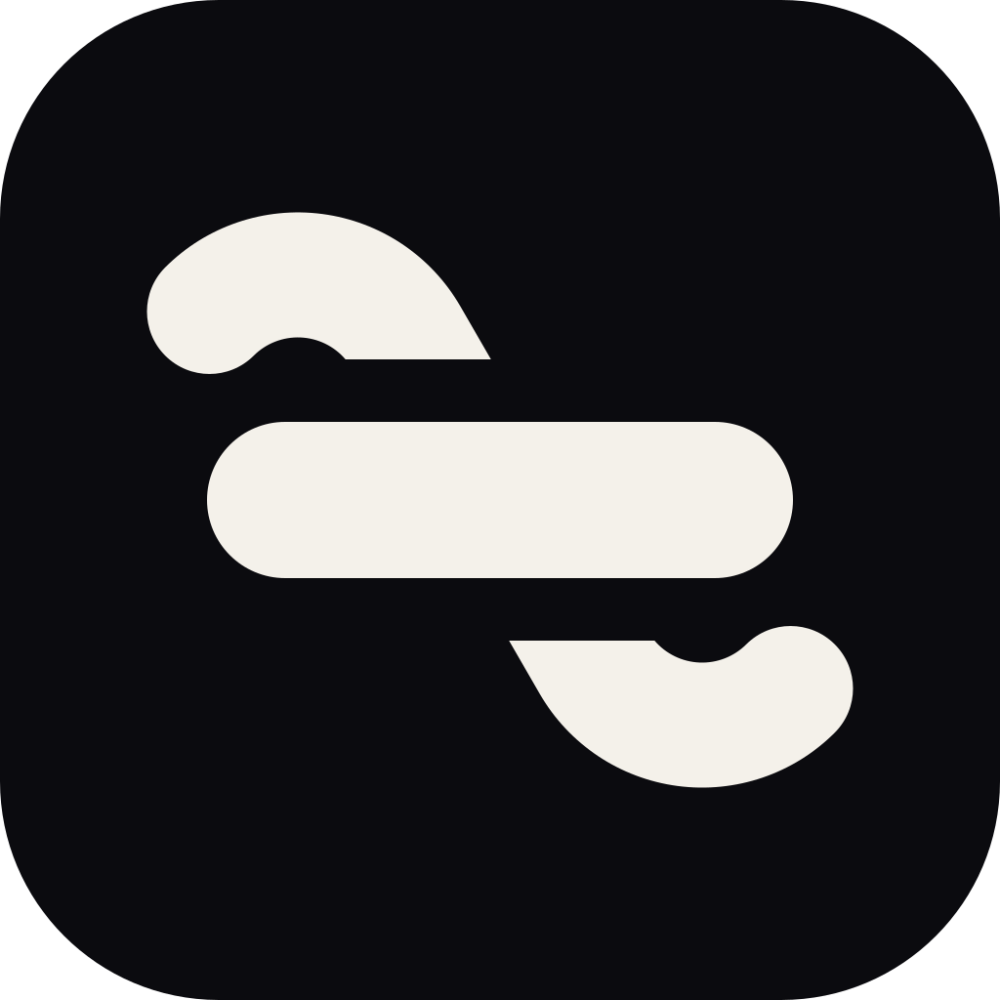
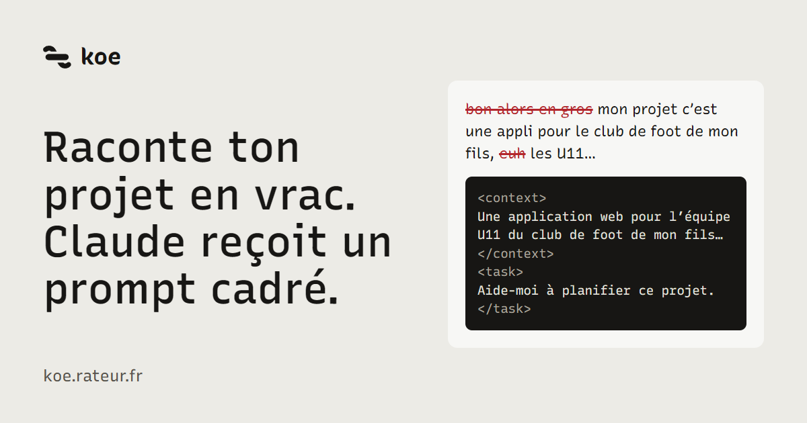

<div align="center">
  
  <h1>Koe</h1>
  <p>Dicte ta demande comme elle vient. Claude reçoit un prompt qu’il comprend.</p>
  <p>
    <a href="https://github.com/Rateur/koe/releases/latest"></a>
    <a href="https://github.com/Rateur/koe/actions/workflows/ci.yml"></a>
    <a href="LICENSE"></a>
  </p>
  <p><a href="README.md">English</a> · <b>Français</b></p>
</div>



Koe est un skill gratuit pour Claude. Raconte ce que tu veux aussi longtemps que tu veux, hésitations et corrections comprises : Koe en fait un prompt structuré, avec le contexte d’abord, puis ce que tu fournis, la tâche, tes exigences et leurs raisons, et le format voulu. Quand le résultat dépend de quelque chose que toi seul sais, il te pose d’abord jusqu’à trois questions courtes, auxquelles tu réponds à voix haute. Il ne lance rien tant que tu ne l’as pas dit.

> [!NOTE]
> Koe en est à ses débuts. La version 0.1.0 transforme une note vocale en prompt XML, pose jusqu’à trois questions quand il manque ce que toi seul sais, signale les mots que la dictée a pu mal entendre et laisse des emplacements pour ce que tu colleras. Suis le dépôt (Custom → Releases) pour être prévenu des nouvelles versions.

## Installer

### Dans l’appli Claude

Avec un forfait payant, ouvre **Personnaliser › Plugins**, clique sur **Ajouter › Ajouter une place de marché** et saisis `Rateur/koe`, puis ajoute Koe depuis **Découvrir**. Il marche sur claude.ai, dans les applis de bureau et de téléphone, et dans Claude Code sur le même compte.

Avec le forfait gratuit, télécharge [koe.zip](https://github.com/Rateur/koe/releases/latest/download/koe.zip) et active l’exécution de code dans **Paramètres › Capacités**. Ouvre ensuite **Personnaliser › Compétences**, clique sur **+** et importe le zip.

### Dans Claude Code

```
/plugin install koe --marketplace Rateur/koe
```

Avant Claude Code 2.1.275, lance `/plugin marketplace add Rateur/koe`, puis `/plugin install koe@koe`. Les places de marché autres que celles d’Anthropic ne se mettent pas à jour seules : lance `claude plugin update koe@koe`, ou active la mise à jour automatique dans **/plugin › Marketplaces**.

### Dans les autres agents

Pour Codex, Cursor, Gemini CLI et les autres agents qui lisent les skills :

```
npx skills add Rateur/koe
```

### Sans rien installer

Dicte dans la zone de [koe.rateur.fr](https://koe.rateur.fr). Elle ouvre Claude avec les consignes de Koe et ta note, ou les copie pour une autre conversation.

## Utiliser

Commence par « koe », ou dis « transforme ça en prompt », puis parle. Dans Claude Code, tape `/koe` et dicte avec `/voice`. Par exemple :

- « koe : j’ai un entretien téléphonique jeudi chez Decathlon, aide-moi à me préparer »
- « transforme ça en prompt : réponds à Mme Garnier pour sa facture en retard, poli mais ferme »
- « koe : le paiement plante depuis la mise à jour de Next.js, Stripe renvoie une erreur, je veux un plan avant de toucher à quoi que ce soit »
- « koe, interviewe-moi : j’aimerais organiser un séminaire d’équipe mais rien n’est décidé »

Le prompt arrive dans un seul bloc de code, qui se copie d’un geste, suivi d’une question : je le lance ici, ou tu le copies dans une nouvelle conversation ou une autre IA ? [references/examples.md](plugins/koe/skills/koe/references/examples.md) montre quatre notes et leurs prompts.

## Ce que Koe garde, et ce qu’il ajoute

- **Chaque détail que tu as donné.** Les noms, chiffres, dates, contraintes et leurs raisons restent, même si le prompt s’allonge. « Une petite appli » reste une petite appli.
- **Tes corrections.** « 20 %, non pardon, 10 % » devient 10 %. Les « euh » et les faux départs disparaissent.
- **Ce qu’il n’est pas sûr d’avoir entendu.** Un mot douteux garde sa meilleure hypothèse et ce qui a été entendu, comme `Qonto [entendu : « Conto »]`, et il est signalé au-dessus du prompt.
- **De la place pour ce que Claude n’a pas.** Le mail auquel tu réponds a sa propre balise, avec un emplacement : `<email>[Colle le mail ici]</email>`.
- **Rien que tu n’aies pas dit.** Pas de règle, d’exemple ou de limite de longueur inventés : Claude fait mieux avec ton intention qu’avec des règles écrites à ta place.

Les règles suivent [les conseils de prompting publiés par Anthropic](https://platform.claude.com/docs/en/build-with-claude/prompt-engineering/claude-prompting-best-practices). [evals/](evals/README.md) explique comment Koe a été testé à l’aveugle contre la note brute, et les limites de ce test.

## Confidentialité

Koe n’est que des consignes : il ne lance aucun script, ne fait aucune requête réseau et ne collecte rien. Le site n’a ni cookie ni mesure d’audience, et ta note ne quitte la page que si tu l’ouvres dans Claude ou la copies.

## Contribuer

Koe est open source mais n’accepte pas de contributions : forke-le et fais-en ta version. [Le guide de contribution](.github/CONTRIBUTING.md) explique le fonctionnement du dépôt, et les agents de code commencent par [AGENTS.md](AGENTS.md).

## Licence

[MIT](LICENSE). Les images du site sont créditées dans son pied de page.

Si Koe t’aide, une étoile aide d’autres personnes à le trouver.
