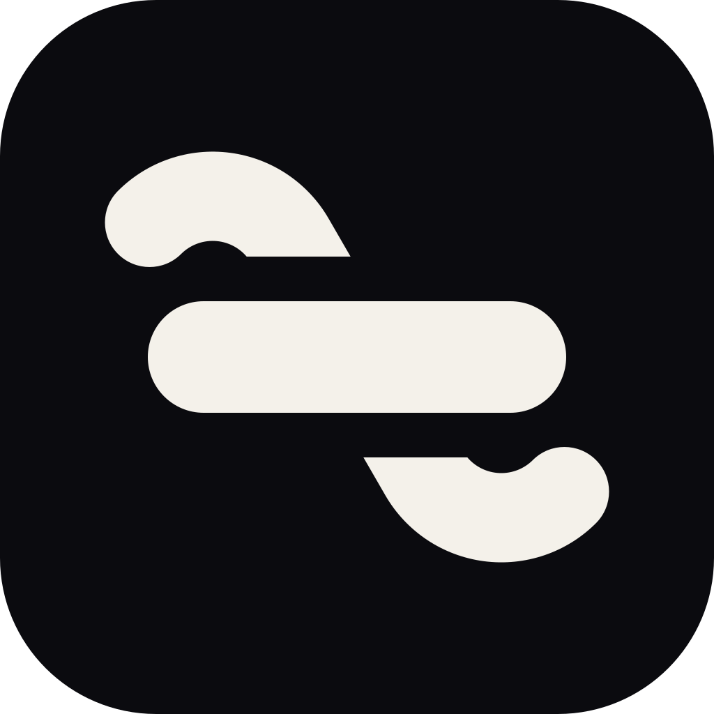
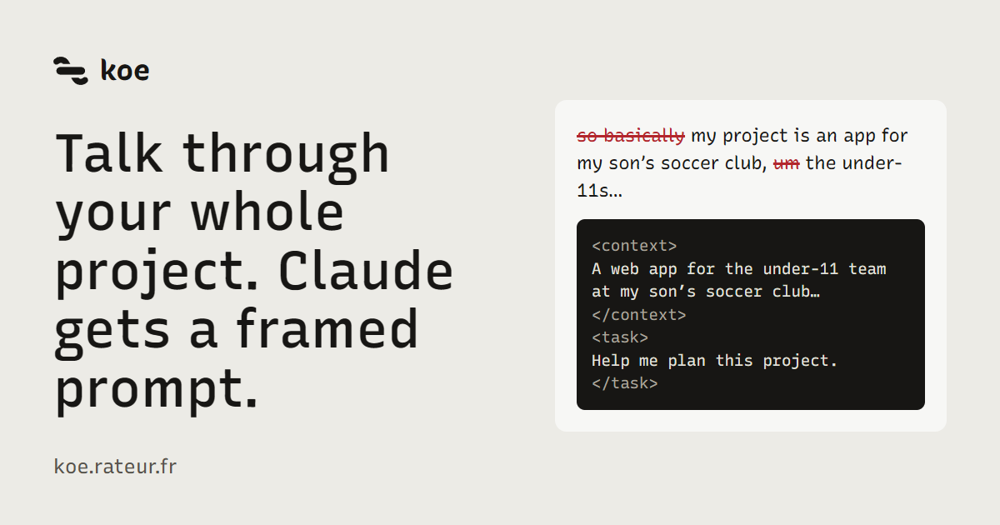

<div align="center">
  
  <h1>Koe</h1>
  <p>Dictate a request the way it comes to you. Claude gets a prompt it understands.</p>
  <p>
    <a href="https://github.com/Rateur/koe/releases/latest"></a>
    <a href="https://github.com/Rateur/koe/actions/workflows/ci.yml"></a>
    <a href="LICENSE"></a>
  </p>
  <p><b>English</b> · <a href="README.fr.md">Français</a></p>
</div>



Koe is a free skill for Claude. Talk through what you want for as long as you like, hesitations and corrections included, and Koe turns it into a structured prompt: the context first, then your material, the task, your requirements with their reasons, and the format you want. When the result depends on something only you know, it first asks up to three short questions you can answer out loud. It never carries out the request until you say so.

> [!NOTE]
> Koe is in early development. Version 0.1.0 turns a voice note into an XML prompt, asks up to three questions when something only you know is missing, flags the words dictation may have misheard and leaves placeholders for what you will paste. Watch the repository (Custom → Releases) to hear about new versions.

## Install

### In the Claude app

On a paid plan, open **Customize › Plugins**, click **Add › Add marketplace** and enter `Rateur/koe`, then add Koe from **Discover**. It works on claude.ai, the desktop and mobile apps, and in Claude Code on the same account.

On the free plan, download [koe.zip](https://github.com/Rateur/koe/releases/latest/download/koe.zip) and turn on code execution in **Settings › Capabilities**. Then open **Customize › Skills**, click **+** and upload the zip.

### In Claude Code

```
/plugin install koe --marketplace Rateur/koe
```

Before Claude Code 2.1.275, run `/plugin marketplace add Rateur/koe`, then `/plugin install koe@koe`. Marketplaces outside Anthropic's don't update by themselves: run `claude plugin update koe@koe`, or turn auto-update on under **/plugin › Marketplaces**.

### In other agents

For Codex, Cursor, Gemini CLI and the other agents that read skills:

```
npx skills add Rateur/koe
```

### Without installing anything

Dictate into the box on [koe.rateur.fr](https://koe.rateur.fr). It opens Claude with Koe's instructions and your note, or copies them for another chat.

## Use

Start with "koe", or say "turn this into a prompt" ("transforme ça en prompt" in French), then talk. In Claude Code, type `/koe` and dictate with `/voice`. For example:

- "koe: I have a phone interview with Decathlon on Thursday, help me get ready"
- "turn this into a prompt: write back to Mrs Garnier about her late invoice, polite but firm"
- "koe: checkout broke after the Next.js upgrade, Stripe throws an error, I want a plan before any change"
- "koe, interview me: I'd like to organise a team offsite but nothing is decided yet"

The prompt comes in one code block that copies in one tap, followed by a question: run it here, or copy it into a new chat or another AI? [references/examples.md](plugins/koe/skills/koe/references/examples.md) shows four notes and their prompts.

## What Koe keeps, and what it adds

- **Every detail you gave.** Names, numbers, dates, constraints and the reasons behind them stay, even when the prompt grows. "A small app" stays a small app.
- **Your corrections.** "20%, no sorry, 10%" becomes 10%. The "um"s and false starts go.
- **What it isn't sure it heard.** A doubtful word keeps its best guess and what was heard, like `Qonto [heard: "Conto"]`, and is listed above the prompt.
- **Room for what Claude won't have.** The email you're answering gets its own tag with a placeholder: `<email>[Paste the email here]</email>`.
- **Nothing you didn't say.** No invented rules, examples or length limits: Claude does better with your intent than with rules made up for you.

The rules follow [the prompting advice Anthropic publishes](https://platform.claude.com/docs/en/build-with-claude/prompt-engineering/claude-prompting-best-practices). [evals/](evals/README.md) explains how Koe was tested blind against the raw note, and the test's limits.

## Privacy

Koe is instructions only: it runs no script, makes no network request and collects nothing. The site has no cookies and no analytics, and your note only leaves the page when you open it in Claude or copy it.

## Contributing

Koe is open source but not open to contributions, so fork it and make it yours. [The contributing guide](.github/CONTRIBUTING.md) explains how the repository works, and coding agents start with [AGENTS.md](AGENTS.md).

## License

[MIT](LICENSE). The pictures on the site are credited in its footer.

If Koe helps you, a star helps other people find it.
